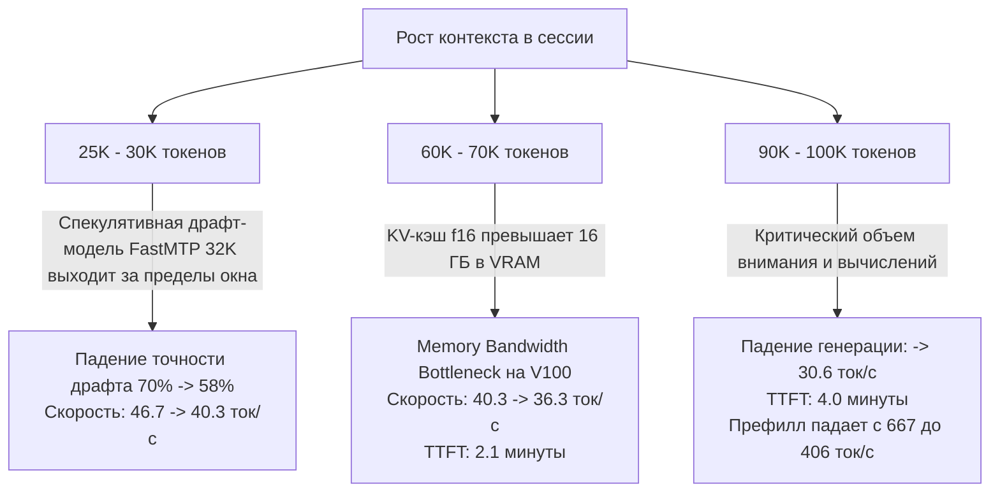

# Отчет: Зависимость скорости генерации токенов от размера контекста в DeepSeek Harness

**Дата анализа:** 14 октября 2026 г.  
**Целевой узел:** `192.168.50.101`  
**Стек:** DeepSeek Harness (`dsh`) / OmniRoute Gateway / `llama-server` (`ghcr.io/ggml-org/llama.cpp:server-cuda`)  
**Оборудование:** 2x Nvidia Tesla V100 32GB PCIe (активный инференс на GPU-0)  
**Модель:** `Qwen3.8-27B-Uncensored-HauhauCS-Aggressive-Q5_K_P.gguf` + сайдкар спекулятивного ускорения `FastMTP 32K`  

---

## 1. Резюме и ключевые выводы

На основе анализа истории сессий DeepSeek Harness, журнала вызовов OmniRoute (`call_logs`, более 3 000 записей) и аппаратных логов движка `llama-server` проведено исследование динамики скорости инференса при масштабировании контекста от 0 до 100 000+ токенов.

### Главные результаты:
1. **Зона пиковой эффективности (Sweet Spot):** **14 000 — 25 000 токенов**. В этом окне чистая скорость генерации составляет **46.7 ток/с** (пики до **55.7 ток/с**), спекулятивный сайдкар FastMTP демонстрирует максимальную точность (**69–92%** принятых драфт-токенов), а время до первого токена (TTFT) остается в пределах **26–34 секунд**.
2. **Первый порог деградации (25 000 — 30 000 токенов):** Скорость генерации падает на **~14%** (до **40.3 ток/с**). Основная причина — исчерпание тренировочного окна сайдкара FastMTP (32K), из-за чего процент принятия драфт-токенов падает с 70% до **58%**.
3. **Второй порог деградации (60 000 — 70 000 токенов):** Падение скорости генерации на **~22%** (до **36.3 ток/с**). Время ожидания первого токена (TTFT) вырастает до **130 секунд (~2.1 минуты)**. Причина — предельная нагрузка на шину памяти HBM2 (900 ГБ/с) из-за разрастания `f16` KV-кэша свыше 16 ГБ VRAM.
4. **Третий критический порог (90 000 — 100 000 токенов):** Падение чистой генерации на **~35%** (до **30.6 ток/с**). Главный фактор «зависания» — колоссальное время префилла (TTFT): пользователю приходится ждать **~4 минуты (236 секунд)** только до появления первого сгенерированного токена.

---

## 2. Сводная таблица производительности

Данные получены путем сопоставления сессий DSH, задач инференса в `llama-server` и записей в шлюзе OmniRoute.

| Диапазон контекста (токенов) | Запросов в выборке | Чистая скорость генерации (ток/с) | Задержка генерации (мс/ток) | Время до 1-го токена (TTFT / префилл) | Скорость префилла (ток/с) | Принятие FastMTP draft (%) | Деградация скорости генерации |
| :--- | :---: | :---: | :---: | :---: | :---: | :---: | :---: |
| **0 — 2 000** | 6 | **35.8** (мед. 40.7) | 33.56 мс | 7.2 с | 350 — 575 | 59.4% | Начальный прогрев / короткие шаги |
| **14 000 — 20 000** | 11 | **46.7** (мед. 46.6, пик 55.7) | **21.59 мс** | 26.1 с | **667.2** | **69.0%** (до 92%) | **0.0% (Оптимум / База)** |
| **20 000 — 25 000** | 5 | **46.0** (мед. 45.0) | 22.22 мс | 34.7 с | 635.0 | 69.9% | **-1.3%** |
| **25 000 — 30 000** | 6 | **40.3** (мед. 42.9) | 25.12 мс | 43.8 с | 611.1 | **58.2%** | **-13.7%** *(1-й порог)* |
| **30 000 — 40 000** | 9 | **40.4** (мед. 39.0) | 25.09 мс | 61.0 с (~1 мин) | 573.9 | 62.0% | **-13.4%** |
| **60 000 — 70 000** | 12 | **36.3** (мед. 36.2) | 27.73 мс | 129.8 с (~2.1 мин) | 487.7 | 61.2% | **-22.2%** *(2-й порог)* |
| **90 000 — 100 000** | 5 | **30.6** (мед. 29.9) | **32.86 мс** | **236.2 с (~4.0 мин)** | **406.5** | **55.6%** | **-34.5%** *(3-й порог)* |

---

## 3. Детальный разбор порогов снижения скорости



### Порог 1: 25 000 — 30 000 токенов (Снижение на 13.7%)
* **Метрика:** Генерация замедляется с 46.7 до 40.3 ток/с.
* **Причина:** В конфигурации контейнера `qwen38-llama-server` задействован механизм спекулятивного декодирования:
  ```bash
  ARGS="$ARGS --spec-draft-model /models/Qwen3.8-27B-FastMTP-32K.gguf --spec-type draft-mtp --spec-draft-n-max 3"
  ```
  Сайдкар `FastMTP 32K` обучен на контекстное окно 32 768 токенов. При контексте до 20K драфт-модель угадывает продолжение текста с вероятностью **до 80–92%** (в среднем 69–70%). Начиная с 25K токенов, качество драфта начинает заметно снижаться, процент принятых токенов падает до **58%**, из-за чего движок чаще отвергает предсказанные токены и выполняет повторные прямые прогоны через основную 27B модель.

### Порог 2: 60 000 — 70 000 токенов (Снижение на 22.2%)
* **Метрика:** Генерация замедляется до 36.3 ток/с, время ожидания начала ответа (TTFT) превышает 2 минуты.
* **Причина:**
  1. **Давление на память (Memory Bandwidth):** Конфигурация запуска использует полноразмерный кэш ключей и значений: `QWEN_CACHE_K=f16`, `QWEN_CACHE_V=f16`. Для 27B модели (48 слоев, RoPE) при 64 000 токенов объем данных в KV-кэше превышает **16 ГБ**. При каждом новом токене ядро FlashAttention вынуждено считывать все эти 16 ГБ из памяти V100 (с пиковой пропускной способностью 900 ГБ/с).
  2. **Экстраполяция RoPE драфт-модели:** Сайдкар FastMTP работает с глубокой экстраполяцией позиционных эмбеддингов за пределы 32K, практически теряя преимущество спекулятивного ускорения.

### Порог 3: 90 000 — 100 000 токенов (Снижение на 34.5%)
* **Метрика:** Скорость падает до 30.6 ток/с, задержка на один токен возрастает до 32.86 мс.
* **Причина:**
  1. Объем одного только KV-кэша при 100K токенов приближается к **25 ГБ**, что оставляет минимум VRAM для промежуточных тензоров (scratch buffers) и активаций.
  2. Внимание по 100 тысячам токенов замедляет как вычисление следующего токена, так и скорость пакетного префилла (`prompt eval` падает с 667 до 406 ток/с).

---

## 4. Восприятие задержки пользователем (TTFT vs Generation)

В веб-интерфейсе DSH пользователь воспринимает задержку интегрально. Сравнение поведения на типичном ответе объемом **500 токенов**:

| Размер контекста | Время префилла (TTFT) | Время генерации 500 токенов | **Полное время ответа (Turnaround)** | Восприятие пользователем |
| :---: | :---: | :---: | :---: | :--- |
| **1 000 токенов** | 2.5 с | 14.0 с | **16.5 с** | Мгновенная реакция |
| **15 000 токенов** | 26.1 с | 10.7 с | **36.8 с** | Комфортная работа |
| **35 000 токенов** | 61.0 с | 12.5 с | **73.5 с (~1.2 мин)** | Заметная пауза перед началом печати |
| **65 000 токенов** | 129.8 с | 13.8 с | **143.6 с (~2.4 мин)** | Ощущение подвисания сессии |
| **96 000 токенов** | **236.2 с (~4 мин)** | 16.3 с | **252.5 с (~4.2 мин)** | Критическое ожидание (риск таймаута) |

> [!WARNING]
> Основным источником субъективного замедления при контексте > 60K является не столько падение скорости самой генерации (с 47 до 30 ток/с), сколько **катастрофический рост времени Time To First Token (префилла)** — до 4 минут на каждый шаг агента.

---

## 5. Роль кэширования промптов (Prompt Cache Reuse)

Анализ таблицы `call_logs` показал интересную аномалию: в диапазоне 70 000 — 90 000 токенов медианная длительность запроса составляла всего **15.3 секунды**.

* **Причина:** Использование механизма повторного использования KV-кэша (`tokens_cache_read = 74 111 токенов`).
* **Эффект:** Когда агент DSH выполняет последовательные мелкие действия (например, запуск тулзов без изменения системного промпта), `llama-server` считывает префилл напрямую из горячего кэша GPU со скоростью, эквивалентной десяткам тысяч токенов в секунду.
* **Однако:** Как только происходит инвалидация кэша (изменение системного промпта, переключение сессии или компактизация), полный пересчет 70–90K токенов занимает от 2 до 4 минут.

---

## 6. Практические рекомендации по оптимизации

1. **Оптимизация порога Compaction (Сжатия контекста):**
   * Рекомендуется зафиксировать порог срабатывания сжатия истории на уровне **30 000 — 40 000 токенов**.
   * Это предотвратит попадание сессии в зону > 60K, где время TTFT превышает 2 минуты, и удержит генерацию в диапазоне максимальной эффективности спекулятивного драфта (40–47 ток/с).

2. **Квантование KV Cache (fp16 -> q8_0 / q4_0):**
   * Включение аргументов `llama-server`:
     ```bash
     -ctk q8_0 -ctv q8_0
     # или для экстремальной экономии:
     -ctk q4_0 -ctv q4_0
     ```
   * Это сократит объем памяти KV-кэша в 2–4 раза (с 16 ГБ до 4–8 ГБ при 64K контекста), снизит нагрузку на шину памяти V100 и предотвратит падение скорости генерации на глубоком контексте.

3. **Спекулятивный драфт:**
   * Если сессии регулярно превышают 32K токенов, целесообразно использовать нативный NextN head без жесткого ограничения 32K сайдкара либо дообучить сайдкар на расширенное окно.
